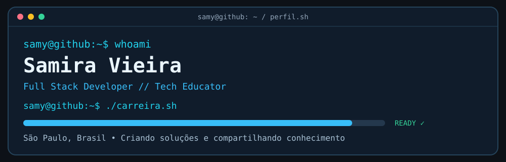
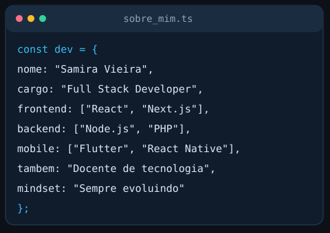
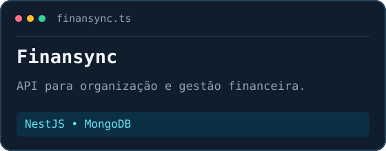
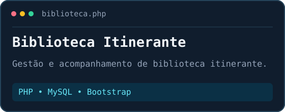
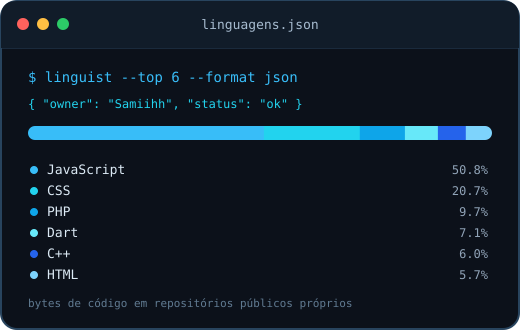

<p align="center"></p>
<p align="center">
<a href="https://www.linkedin.com/in/samira-vieira-de-souza-1b6996129"></a>
<a href="https://portifolio-samiravieira.vercel.app/"></a>
<a href="mailto:samira.v.souza20@gmail.com"></a>

</p>




[](https://git.io/typing-svg)

Sou **desenvolvedora Full Stack**, com atuação em aplicações web e mobile, do **React e Next.js** ao **Node.js e PHP**. Desde 2022, venho transformando ideias em soluções digitais, valorizando código limpo, boas práticas e trabalho em equipe.

Também atuo como **docente de tecnologia**, compartilhando conhecimento e ajudando outras pessoas a dar seus primeiros passos na programação.

```diff
+ Construindo aplicações, APIs e experiências digitais
+ Compartilhando conhecimento e aprendendo sempre
+ Explorando novas tecnologias e boas práticas
- Bugs em produção (seguimos trabalhando nisso!)
```
<br clear="right"/>


<p align="center"></p>


<table>
  <tr>
    <td width="50%">
      <a href="https://github.com/Samiihh?tab=repositories">
        
      </a>
    </td>
    <td width="50%">
      <a href="https://github.com/Samiihh?tab=repositories">
        
      </a>
    </td>
  </tr>
  <tr>
    <td width="50%">
      <a href="https://github.com/Samiihh/copa-do-amor-2026">
        
      </a>
    </td>
    <td width="50%">
      <a href="https://github.com/Samiihh?tab=repositories">
        
      </a>
    </td>
  </tr>
</table>


<table>
  <tr>
    <td width="50%"></td>
    <td width="50%"></td>
  </tr>
</table>


<p align="center"></p>

<p align="center"></p>
