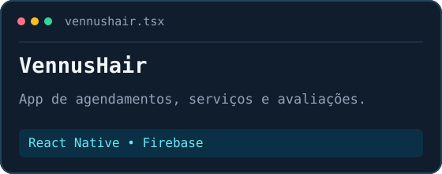
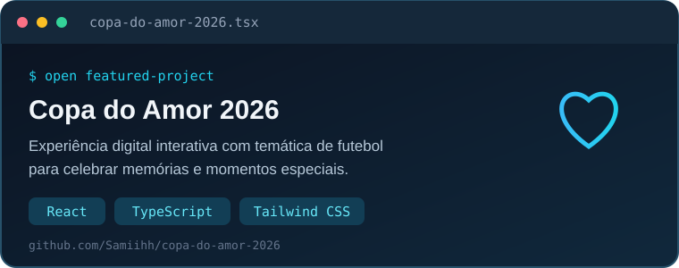
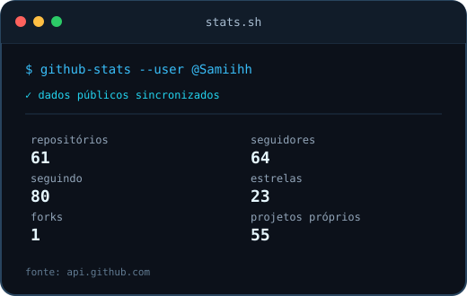
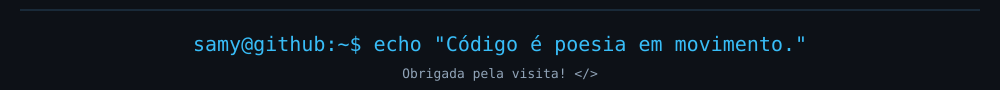

<table>
  <tr>
    <td width="54%" valign="top">
      
      
Sou <strong>desenvolvedora Full Stack</strong>, com atuação em aplicações web e mobile, do <strong>React e Next.js</strong> ao <strong>Node.js e PHP</strong>. Desde 2022, venho transformando ideias em soluções digitais, valorizando código limpo, boas práticas e trabalho em equipe.

      
Também atuo como <strong>docente de tecnologia</strong>, compartilhando conhecimento e ajudando outras pessoas a dar seus primeiros passos na programação.

      <pre><code>+ Construindo aplicações, APIs e experiências digitais
+ Compartilhando conhecimento e aprendendo sempre
+ Explorando novas tecnologias e boas práticas
- Bugs em produção (seguimos trabalhando nisso!)</code></pre>
    </td>
    <td width="46%" valign="top">
      
    </td>
  </tr>
</table>

<table>
  <tr>
    <td width="50%">
      
    </td>
    <td width="50%">
      
    </td>
  </tr>
  <tr>
    <td width="50%">
      
    </td>
    <td width="50%">
      
    </td>
  </tr>
</table>

<table>
  <tr>
    <td width="50%"></td>
    <td width="50%"></td>
  </tr>
</table>

